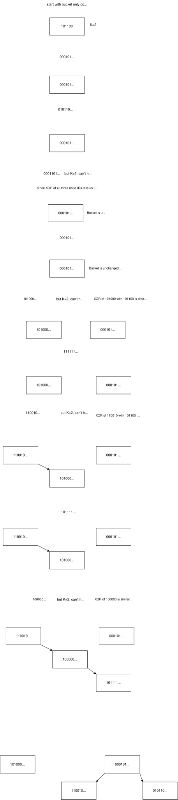

# ATN Exercise 4

---

Author: Suvansh Shukla  
Matriculation No: 256245

---

## Q 1

Solution was drawn on a webapp: [LINK](app.diagrams.net)

Solution file is: 

## Q 2

| Action                                                                         | types        |
|--------------------------------------------------------------------------------|--------------|
|Reactively replicates popular content                                           |    Both      |
|Reduces origin server costs                                                     |    Reverse   |
|Reduces client ISP costs                                                        |    Forward   |
|Intelligent load balancing between origin servers                               |    Reverse   |
|Offload form submissions (POSTs) and user auth                                  |    Reverse   |
|Content reassembly or transcoding on behalf of origin                           |    Both      |
|Smaller round-trip times to clients                                             |    Both      |
|Maintain persistent connections to avoid TCP setup delay (handshake, slow start)|    Both      |

## Q 3

